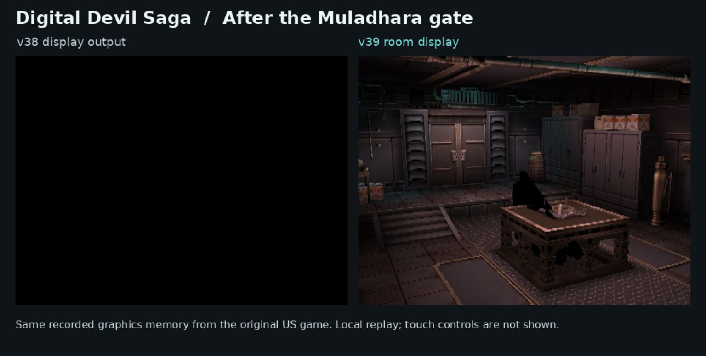
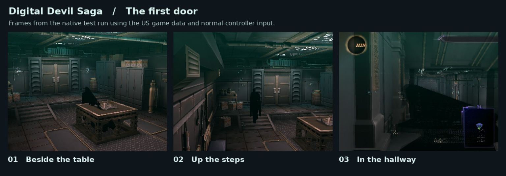
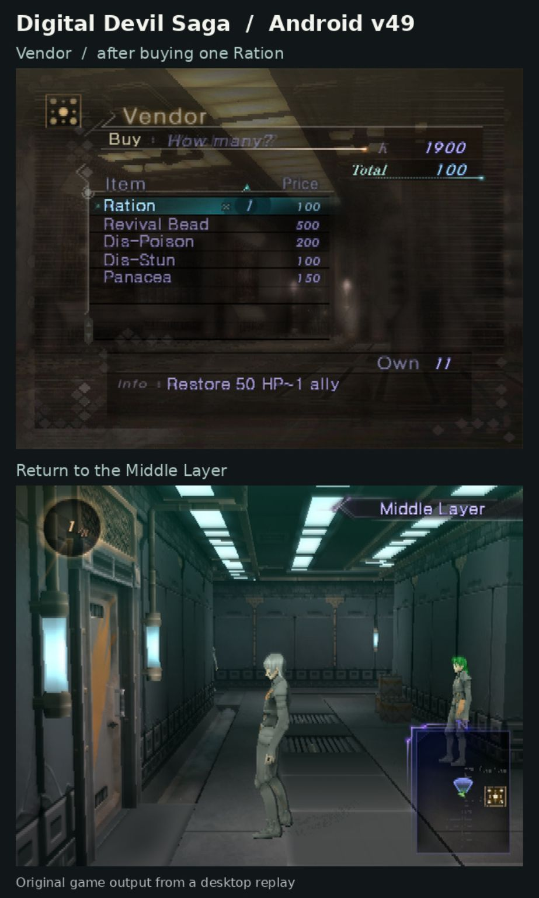

Okay it's a tad related.

GTA VI dropped today and I spent the day slowly playing the opening levels as we attempted to resume work on Digital Devil Saga.

It was an extremely satisfying push, before we were just hitting an absolute wall with just getting the ATLUS logo to render but FINALLY made some headway and here's the fruits of that. We're still probably only running 23-28% actual game speed.

Still a metric ton of work to be done, but a fun little detour. 🤘

